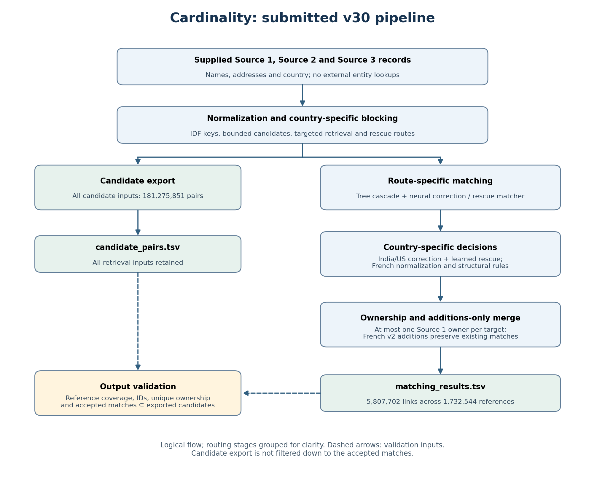
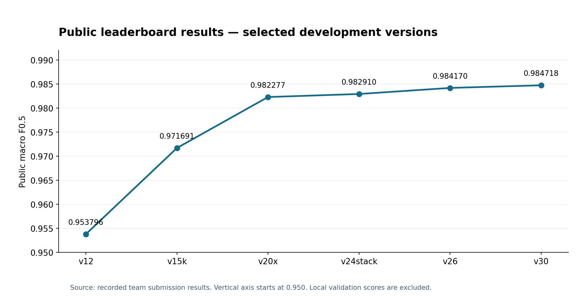

# ML Challenge 2026: Business Entity Resolution

**Team Name:** Cardinality  
**Team Members:** Ashin Murugan, Cherin Yacoob, Neha R, Harisankar G  
**Submission Date:** 27 September 2026 (final leaderboard submission); methodology prepared 28 September 2026  
**Final submission:** `matching_results.tsv` (version v30), public macro F0.5 **0.984718**

---

## 1. Executive Summary

The pipeline has four parts:

1. **Blocking.** Country-partitioned, inverse-frequency key blocking in DuckDB, plus four targeted retrieval routes,
   produces 181.3 million candidate pairs. That is 0.0027% of all same-country pairs.
2. **Matching.** Two-stage gradient-boosted tree models score every pair. A fine-tuned multilingual cross-encoder
   and a correction model then re-score the uncertain pairs.
3. **Decision.** Global one-owner-per-target resolution: each Source-2/3 record goes to its single best reference.
4. **France.** France has no training labels. We transferred matching behaviour from India/US by measuring how
   corruption and decoy patterns co-occur in the unlabeled data, and used that to correct the French text
   normalization fed to the neural model.

The held-out India/US macro F0.5 is 0.9896.

---

### Pipeline diagram

## 2. Methodology

### 2.1 Problem Analysis

Exploratory analysis of the training labels and of the unlabeled test data shaped every design choice.

**Structure of the matches**
- Every Source-2/3 record belongs to **at most one** reference, so one-owner-per-target is a hard constraint.
- References average **3.46** true matches in both India and US, with similar distributions; 5.6% have none.
- 26% of training targets belong to no reference. These are distractors, and they almost never share a
  reference's exact address.

**How Sources 2 and 3 connect to Source 1 (training labels)**

Each Source-1 row lists its linked Source-2 and Source-3 IDs in `matched_entity_ids`; an empty list means no
known link. We counted all 2,206,821 training references and their labels, including empty lists:

| Country and target source | Target records | Linked to a reference | References with at least one link from that source |
| --- | ---: | ---: | ---: |
| India, Source 2 | 2,017,799 | 73.4% | 87.0% |
| India, Source 3 | 2,115,547 | 74.7% | 87.9% |
| US, Source 2 | 3,016,817 | 73.4% | 86.9% |
| US, Source 3 | 3,170,056 | 74.6% | 87.9% |

The mean links per reference are 1.67 from Source 2 and 1.79 from Source 3. In the labeled data, the
commonest per-reference link pattern is one link from each source, followed by (one, two), (two, one), and
(two, two). Source-2 and Source-3 records enter one target pool; source identity remains a model feature,
and the final decision assigns each target to at most one Source-1 reference. These are training-label
statistics, not a claim about the unlabeled French test records.

**Name noise**
- Native-script Indian names and addresses: the target data contains Devanagari, Kannada, Bengali, Gujarati,
  Gurmukhi, Odia, Tamil, Telugu and Malayalam. For example, `राम` is transliterated *from* Devanagari
  to `ram`, and `ಕನ್ನಡ` is transliterated *from* Kannada to `knnd` by the pinned `anyascii` library.
  This is normalization toward the Latin-script reference text, not translation of business meaning.
  The full name and address are transliterated before token normalization; native-script state names are
  then mapped to state codes where a known mapping exists. A lexicon learned only from non-held-out
  training links corrects recurring transliteration spellings; a consonant skeleton helps with unseen variants.
- French names and addresses can contain accents. `anyascii` folds characters such as `é`, `è`, `à`,
  `ç` and `ï` to Latin letters before comparison. French legal forms are handled in the core-name view,
  and known region/département equivalents are mapped only for whole address components.
- OCR digit swaps ("5ervices", "hea1th").
- Glued web domains ("pediatricdentistryassociates.com").
- Honorific prefixes, ID tags, "DBA/AKA" aliases and word shuffles.
- Acronyms ("LPS" for "Life Petit Sport").
- Complete rebrands into invented words ("Veosol", "Onyxpyra").
- A recurring **"drop one word + append a generic suffix"** corruption ("Clear Smart Holding LLC" becomes
  "Clear Holding LLC Services"). In India/US the true-match suffixes are Services, Center and Partners. Suffixes
  such as Group, Enterprises, Industries and Bros mark *different* businesses (under 1% true when added at a
  shared address).

**Address noise**
- Perturbed or suffixed house numbers ("1121" vs "1121A").
- Truncated addresses ("51 block c rohit kunj pitampura dl n w dl" becomes "dl 51 n w dl").
- Component reordering and street/city typos.
- State names in native script.
- In France, region names replaced by département names.

**Missing addresses:** 3–4% of targets have no address. Of these, 97.7% still belong to some reference, and
they are the hardest case when several references share the name.

**Test-set differences**
- About 5.8 target records per reference, against 4.7 in training, so the candidate pool is denser.
- A third country, France (15% of references), with French legal forms (SARL, SAS, EURL, SCI), French generic
  suffixes ("& Fils", "Groupe", "& Associés", "Développement") and decoy sibling businesses at shared addresses.

### 2.2 Solution Strategy

**Approach Type:** Blocking + multi-stage classifier + neural re-scoring + global assignment (hybrid).  
**Core approach:** Measured corruption and distractor patterns motivated targeted fixes:
- **Blocking routes** aimed at the matches that key blocking loses.
- **Transfer to France without labels.** A corruption pattern is identified by how often a token that a target
  adds appears at the reference's own address. The observed co-location rates motivated hypotheses about French suffixes and informed normalization and rules. These measurements do not establish French match precision, because French labels are unavailable.

Validation holds out ~4.5% of Source-1 identities (hash of the identity ID), with their matches, and splits them
into a *tune* half and a *final* half. The base tree and neural models exclude these held-out identities. The blend, correction model and rescue matcher use the *tune* identities, with grouped cross-validation for the learned correction/rescue models. Reported final scores use the separate *final* identities. This final split was inspected across multiple experiments, so it is a reused validation estimate rather than an untouched independent test. The metric is the exact per-reference macro F0.5. Every
reference counts, including those with no matches and those whose matches were never retrieved.

---

## 3. Candidate Generation (Blocking)

**Blocking keys used**

- **Normalization first.**
  - Transliteration of non-Latin scripts to ASCII (anyascii).
  - A transliteration lexicon learned from training identities only.
  - Abbreviation and ordinal canonicalization ("private limited" → "pvt ltd", "street" → "st").
  - Removal of legal forms and filler words to form a *core name*.
  - OCR-digit repair and splitting of glued domains using reference-name word frequencies.
  - Honorific, ID-tag and URL-tail removal; alias resolution ("X DBA Y" → "Y").
  - Address cleanup: zero padding, "null", filler words such as "door/plot/unit".
  - France: region/département harmonization.
  - A phonetic consonant skeleton for transliteration variants.
- **Hashed keys, namespaced by country and field:**
  - core-name tokens, adjacent-token concatenations, first-three-token concatenation and the whole core name;
  - name-token × address-word keys, so that generic names still block within their city;
  - address tokens and adjacent address bigrams.
- **Scoring and caps.** Keys held by more than 300 targets are dropped. A pair's score is the sum of inverse
  document frequencies of the keys it shares (total, name-only and address-only). Each reference keeps the union
  of its **top 80 by total score, top 40 by name and top 40 by address**. This way both renamed businesses (address
  evidence only) and name-only targets (name evidence only) survive.
- **Four targeted routes recover what key caps lose:**
  - **A:** same core name, target without an address (core names shared by ≤1,000 targets).
  - **B:** same exact address sharing at least one core word (addresses shared by ≤50 targets).
  - **C:** name keys counted *within the name-only target pool*, so a name too common in the full pool can still
    retrieve its address-less variants (top 16 per reference).
  - **Rescue:** same first core word and same leading house number, pairs not yet produced. These are kept when
    the name edit ratio + address token-set ratio ≥ 1.5. The route targets common names whose true match was cut
    by the per-reference cap, typically with a truncated or misspelled address.

**Candidate pairs generated:** **181,275,851** for 1,732,544 references, about 105 per reference. The full
same-country comparison space is 6.72 × 10¹², so the reduction ratio is **99.9973%**.

**How retrieval losses were measured**
- Pair recall was measured on the held-out identities (98.5% of true links retrieved before the rescue route),
  together with the *candidate oracle*: the macro F0.5 if every retrieved pair were classified perfectly
  (**0.9958** on the v24 final-half candidate pool before later rescue additions). This is an oracle bound for that pool, not an achieved score.
- Retrieval routes were assessed on labeled India/US data for recall and candidate cost. French additions were based on transferred patterns and unlabeled analysis; their accuracy is not established by the India/US oracle.
- Candidate generation never uses labels. The exported `candidate_pairs.tsv` is exactly the set the matching models
  score, and every accepted match is contained in it.

---

## 4. Matching Model

**Features used (stage 1: 59 per pair)**
- **Name features:** Levenshtein ratio, token-sort, token-set and partial ratios and Jaro-Winkler on the name.
  Ratio and token-set similarity on the core name; ratio and partial ratio on the raw (unmapped) name. Also:
  - exact and no-space core equality;
  - first-token edit distance, prefix and suffix agreement;
  - phonetic-skeleton similarity;
  - core-name subset flags and name lengths.
- **Address features:**
  - ratio, token-sort/set and partial similarities;
  - house-number agreement (Jaccard of number tokens, common, conflicting, first number equal, relative and log
    differences, one-digit substitution, number contained in the other address);
  - address subset flag, lengths and a target-address-missing flag.
- **Blocking and frequency features:**
  - total, name and address IDF scores and their ranks for the reference;
  - score relative to the reference's best and to the target's best reference;
  - key and route counts;
  - how common the name and address are in the whole pool;
  - target source (Source 2 or Source 3).
- **Context (stage 2, 17 more):**
  - the stage-1 probability, its rank, maximum, sum and count above 0.5 among the reference's candidates;
  - the target's rank among competing references, the best competing probability and the gap to it;
  - "anchor" similarity: how closely the target resembles the reference's strongest other candidates.

**Model type**

1. **Stage 1 and stage 2: gradient-boosted trees** (XGBoost on GPU; 63 leaves, learning rate 0.03, up to 2,500
   rounds, row/column subsampling 0.8).
   - Stage 1 is trained as two models on disjoint halves of the training references, so every training pair gets
     an out-of-fold probability for the stage-2 context features.
   - Training uses hard negatives (each reference's top 15 ranked candidates) plus 12% of the remaining negatives,
     with square-root reference weighting.
2. **Cross-encoder (neural pair classifier).**
   - multilingual-e5-small (MIT license), fine-tuned on hard training pairs formatted as "name | address";
     inputs are truncated to 112 tokens.
   - It re-scores pairs whose stage-2 probability lies between 0.002 and 0.9995.
   - A logistic blend of [logit p, cross-encoder logit, their product] is fitted on the tune half.
   - An e5-base fine-tune contributes a second neural score where available.
3. **Correction model.** LightGBM with 600 trees, 15 leaves, depth 5, learning rate 0.04 and L2 regularization
   15. It runs on the uncertain band with 63 features:
   - stage probabilities and both neural scores;
   - name, core-name, address and raw-name similarities, exact-match flags and lengths;
   - missing-address flags, digit conflict and overlap, word overlap;
   - whole-pool name frequencies and interaction terms.

   It is trained on tune-half identities with grouped 3-fold cross-validation.
4. **Rescue-route matcher.** Regularized logistic regression (C = 0.1) on 42 name, address, missingness,
   digit-agreement and name-frequency features, trained on tune-half rescue pairs. It accepts at probability ≥ 0.69.
5. **France-specific handling (no labels):**
   - **Neural input normalization.** French legal forms map to their closest English forms (SARL/EURL/SCI → LLC,
     SAS/SASU → Inc, SA → Corp). French suffixes map by *measured behaviour*. "& Fils", "Frères", "Groupe" and
     "Développement" co-locate with the reference's address 4–20% of the time, like the true-match suffix
     "Services", so they map to Services; "Associés" maps to Partners. "Holding", "Participations" and
     "Distribution" co-locate only 0.03% of the time, like decoy suffixes, so they map to "Group".
   - **Structural rules transferred from India/US patterns,** each 87–99.9% precise on India/US labels:
     - same address, reference name minus one word plus a generic suffix;
     - an invented rebrand token at the address of a reference that is alone there;
     - a name-only target whose core name belongs to exactly one reference;
     - identical name at a different address, but only when the legal form is not swapped. A swapped legal form
       ("X SARL" vs "X EURL") is treated as a possible sibling business: in US data it is only 31% true.
   - **Decoy families left out:** in-place word swaps between French organization words ("Club" ↔ "École").
     These are more frequent in France than in the US; we treated that as evidence for a conservative exclusion, not proof that every such pair is a distractor.

**Threshold selection method**
- Exact macro F0.5, including one-owner-per-target resolution, maximized on the tune half: coarse grid, then
  refinement. Result: 0.74 on the correction-model scale for India/US.
- France has no labels, so its threshold (0.925 on the blended scale) was chosen conservatively and checked with
  leaderboard feedback. A lower threshold (0.60) did not improve the score.
- **Final decision:** keep pairs above the threshold, then assign each target only to its highest-scoring
  reference.

---

## 5. Results & Error Analysis

| Version (key change) | Public macro F0.5 |
|---|---:|
| Two-stage trees, basic cleaning | 0.954 |
| Cleaning, lexicon, larger training set | 0.972 |
| Cross-encoder blend, country-specific thresholds | 0.982277 |
| Correction model on the uncertain band | 0.982910 |
| Rescue route, French structural rules | 0.984170 |
| **Learned rescue matcher, corrected French neural normalization (final)** | **0.984718** |

- **F0.5 score (macro, held-out India/US final half, 50,689 references):** **0.9896**. The candidate oracle is
  0.9958 for the earlier v24 candidate pool. Separately, on 50,141 **tuning** references with the learned rescue, the score is 0.989834 and the candidate oracle is 0.996767. Its error decomposition attributes about 60% of remaining macro loss to rejected retrieved true pairs, 32% to unretrieved true pairs and 8% to false accepted pairs. These tuning statistics are not final-half statistics.
- **Common false positives (wrong merges):**
  - businesses with the same name and a different legal form in another city ("X LLC" vs "X Inc");
  - co-located sibling businesses at one address that differ by one word (very common in France:
    "Faune Club SARL" vs "Faune École SARL");
  - common-name records without an address.

  For a nonempty reference, F0.5 = 5TP / (5TP + 4FP + FN), and an empty prediction with empty truth scores 1. The decision rules deliberately
  favour precision. Accuracy on references with no true match is about 99.8%.
- **Common false negatives (missed matches):**
  - Address-less records whose name is shared by two or more references. In training, the records' spelling,
    source and the references' link counts pick the true owner only 55–58% of the time, so these are left
    unmatched rather than guessed.
  - Matches lost at blocking: typos in both name and street, truncated addresses, and invented rebrand names at a
    different address.
  - French matches the models, trained on India/US text, under-score. The last two versions addressed this.

---

## 6. Conclusion

A measured, pattern-driven pipeline reached a held-out macro F0.5 of 0.9896 on India/US and 0.9847 on the public
leaderboard: key blocking with targeted recovery routes, boosted trees with competition context, a fine-tuned
multilingual cross-encoder, calibrated correction models and one-owner-per-target assignment. The most useful
lesson was that unlabeled data can still be measured. Co-occurrence with addresses motivated French normalization hypotheses. The final submission improved the aggregate public score, but without French labels we cannot independently establish French precision or assign the full gain to one normalization change.
The largest remaining gains are domain adaptation for France (pseudo-labelling from high-precision patterns) and
dense embedding blocking for the denser test pool.

---

## Appendix

### A. Code Artefacts

- `code/business_entity_resolution/src/fast_er/`: the main pipeline.
  - `prep.py`: normalization.
  - `lexicon.py`: learned transliteration lexicon.
  - `block.py`: key blocking and routes A–C.
  - `model.py`: features, two-stage boosted trees, context features, threshold selection.
  - `run_stage1.py`: normalization, lexicon and blocking for a split.
  - `run_stage3.py`: features, training, prediction and export.
- `code/business_entity_resolution/src/correction/`: correction model and feature computation.
- `code/business_entity_resolution/src/rescue/`: rescue retrieval and learned matcher.
- `code/business_entity_resolution/src/crossencoder/`: neural inference and French input normalization.
- `code/business_entity_resolution/src/france/`: structural rules and additions-only merge.
- `code/business_entity_resolution/src/checks/`: output checks.
- `code/business_entity_resolution/models/`: saved tree/correction/rescue weights, tokenizers, lexicons,
  neural test-score caches and hash manifests. The two fine-tuned e5 weight files were omitted to meet the
  portal's 1,024 MB ZIP cap; the README documents the test-specific saved-score replay and its limits.
- **Reproduction:** `code/business_entity_resolution/README.md` describes saved-model execution and retraining prerequisites; `reproduce.sh` is the saved-model command chain. The current package has not passed a complete clean-room reproduction. An earlier partial replay encountered memory failures. Follow-up analysis found 13,786 neural-score differences but no changed 0.925 threshold decisions or selected owners at that French decision step. This limited check does not establish complete clean-room reproduction. The packaged output files are byte-identical to the selected competition artifacts, which is distinct from proving end-to-end reproduction.

### B. Additional Results

- Held-out final half, per country, with the fixed-threshold rescue: India 0.9890, US 0.9896. The learned rescue
  matcher raised the joint India/US score from 0.98935 to 0.98958.
- Output integrity for the final files: 1,732,544 references, all present; 5,807,702 matches, each target assigned
  to at most one reference; no cross-country links; every match inside the candidate set; the competition log records successful output checks. The current package audit confirms exact output hashes; it does not claim a new successful official full-candidate validator run.

**Compliance:**
- Only the supplied data is used. There are no external business registries, geocoding or hosted inference APIs.
- Entity IDs and row order are never used as features.
- The pretrained model (multilingual-e5, MIT license) runs offline.
