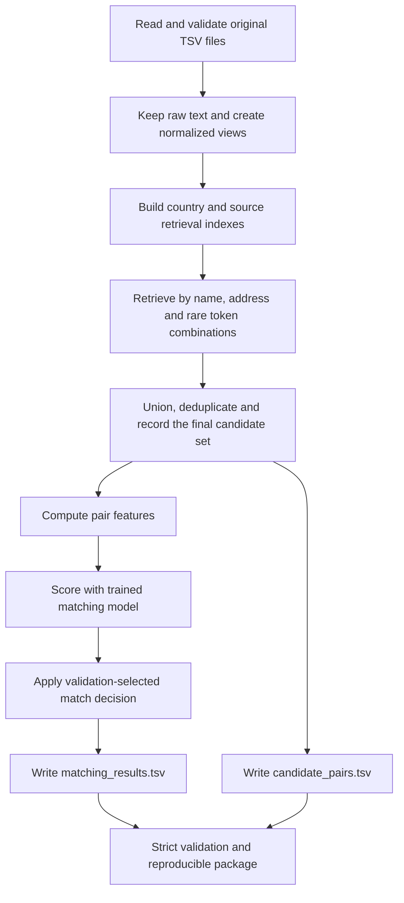

# Amazon ML Challenge 2026: implementation guide

Prepared on 25 September 2026, before implementation. Read this document first, then [the measured data report](DATA_RESEARCH_REPORT.md) and [the function reference](FUNCTION_REFERENCE.md).

This is the working design, not a claim of full challenge model training. The runnable CPU baseline and its deviations from this wider experiment plan are specified in [BASELINE_IMPLEMENTATION.md](BASELINE_IMPLEMENTATION.md). Use [RUNBOOK.md](RUNBOOK.md) for current commands and [IMPLEMENTATION_STATUS.md](IMPLEMENTATION_STATUS.md) for verified progress. Proposed improvements must earn their place through validation. The source PDFs, README, validator and all seven data files were inspected. Dataset statistics below come from a complete local scan, except where explicitly marked as sampled.

## 1. What we are building

For every business in Source 1, return all records in Sources 2 and 3 that describe that same business. A reference business can have zero, one, or multiple matches, including several in the same source. This is supervised record linkage with an explicit no-match decision.

Inputs have four fields: `entity_id`, `business_name`, `business_address`, `country`. Ground truth associates each training Source 1 ID with a comma-separated set of target IDs. IDs are identifiers, not predictive features. Their numeric values and file positions must not be used to infer matches.

The recommended first model is a tree classifier over string and address similarity features, behind a high-recall candidate generator. Multilingual embeddings are a later, measured addition. We have no evidence yet that an LLM is necessary or that GPU training is the bottleneck.



The exported candidate file must describe precisely the pairs presented to the final matcher. Save the candidate set before scoring. Do not reconstruct it afterward from accepted matches.

## 2. Confirmed rules and conflicts

| Item | Evidence and operational rule |
|---|---|
| Challenge window | Guidelines: 25 September 2026 00:00 IST through 27 September 2026 23:59 IST. |
| Upload limit | Maximum five leaderboard submissions per day. Maintain version history and record timestamps, file hashes and scores. |
| Main score | Macro F0.5, computed separately for every Source 1 business, including singletons. |
| Live upload | `matching_results.tsv`, UTF-8 and tab-separated. |
| Final archive | Both output TSVs, runnable source, pinned dependencies, reproduction README and completed methodology template. |
| Model restriction | Final model must satisfy MIT/Apache 2.0 licensing and the stated maximum of 8 billion parameters. Audit each pretrained component separately. |
| External data | No business-registration lookup, commercial entity-resolution API, geocoding service or external data augmentation. Research software methods without searching actual business rows. |
| Countries | Training has US and India. Test additionally has France. Unknown countries must remain supported. |
| Competition access | Guidelines prohibit multiple challenge registrations/IDs and simultaneous portal logins. This does not establish what a separate compute provider permits. |
| Write-up length conflict | Guidelines request 1–2 pages; task README/PDF say the methodology template has no page limit. Prepare a concise 1–2-page summary and the detailed filled-in template/appendix. |
| Ranking conflict | Task-specific PDF says final ranking is private-leaderboard based. General guidelines mention both public and private. Preserve all submission versions and optimize a reliable local holdout; do not assume public score alone decides ranking. |
| Validator conflict | README/PDF say nonexistent targets are rejected. Supplied validator comments say they only reduce score. Our code must reject unknown targets either way. |

The supplied validator skips ID-existence checks by default, accepts an absent candidate file with a warning, and only warns when final matches are outside candidates. Its `PASS` therefore does not prove the complete final package is correct. Our internal checks will be stricter.

## 3. Dataset scale and design consequences

- Training references: **2,206,821**. Training target records: **10,320,219**.
- Test references: **1,732,544**. Test target records: **9,969,589**.
- Labeled positive links: **7,638,365**. Training singletons: **123,247 (5.5848%)**.
- France contributes **259,452 test reference businesses (14.9752%)** and has no training labels.
- Exhaustive test comparison requires **17,272,751,604,416 pairs**. Even country blocking leaves **6,724,569,566,212 pairs**.
- Forty final candidates per test reference would already mean **69,301,760 scored pairs**. Forty is an illustration, not an approved fixed cap.

Never materialize a full pair matrix. Process target indexes and reference queries in bounded chunks. Persist intermediate results so a restart does not repeat expensive work. Benchmark both candidate recall and throughput before committing to full inference.

At inspection, this laptop had about 19.86 GiB physical RAM and only 3.11 GiB available. This is a changing snapshot. Reserve memory for the operating system; start small and measure peak resident memory. Do not load all sources as Python dictionaries or all candidate features into a single DataFrame.

## 4. The exact metric

For one reference entity, let `T` be its true target-ID set and `P` its predicted set:

1. If both are empty, score 1.
2. If exactly one is empty, score 0.
3. Otherwise let `tp = |T ∩ P|`, `fp = |P − T|`, `fn = |T − P|`.
4. Score `5*tp / (5*tp + 4*fp + fn)`.
5. Average the scores over **all** reference entities, including entities with no retrieved candidates.

This is algebraically equivalent to the official F0.5 formula. The false-positive and false-negative coefficients are 4 and 1 in this count expression; a slogan about a fixed business cost should not replace the actual calculation.

| Truth | Prediction | Entity score |
|---|---|---:|
| empty | empty | 1 |
| empty | one incorrect ID | 0 |
| two correct IDs | empty | 0 |
| two correct IDs | both correct | 1 |
| two correct IDs | both plus one false match | 10/14 = 0.714286 |
| two correct IDs | one correct | 5/6 = 0.833333 |

An all-empty prediction scores **0.0558482** on the supplied training labels. This is a scoring sanity check, not a competitive solution. Ordinary pairwise accuracy, binary F0.5, or a micro-average is not the challenge metric.

Also report candidate recall, candidate oracle macro F0.5, singleton accuracy, false-positive rate on singletons, match count, and per-country results. The candidate oracle predicts only retrieved true matches and provides a more relevant upper bound than link recall alone.

## 5. Data ingestion and normalization

### Input contract

Read with explicit tabs, UTF-8, and string IDs. Empty addresses are legitimate. Do not let a parser convert empty strings or business strings such as `NA` into missing-value sentinels. Keep original files unchanged. Fail visibly on malformed schemas, duplicate IDs, invalid source prefixes and missing expected labels.

Store country as an unrestricted normalized string. Keep the raw country label for reports. Country compatibility may be a strong block because all 7.64 million training positives have matching countries, but preserve a fallback for blank or unknown labels. Do not equate a newly encountered country such as France with missing data.

### Text views

Maintain raw text, a Unicode-preserving normalized view, and an optional Latin-accent-folded view. Use Unicode NFKC, case folding, punctuation separation and whitespace collapse. Preserve combining marks used by Indic scripts. Accent folding must not erase Indic vowel marks or turn a non-Latin name into an empty string.

For names, add a second, gently reduced view for observed legal suffixes. Keep the original normalized view as a feature. `Ltd` removal can help retrieval but must not erase a meaningful business-name distinction. Learn optional alias/transliteration mappings only from the training fold, with support counts and ambiguity controls.

For addresses, keep digit-bearing tokens, unit numbers, slash/hyphen structure in an additional raw-derived view, postal-code candidates and rare tokens. Treat extracted numbers as evidence with confidence, not as guaranteed house or postal numbers. In France, five-digit numbers can be postal codes; in India, six-digit numbers can be PIN codes. Extraction must remain robust when these are absent. Do not use an external location database.

Avoid blanket replacements such as `st -> street`: `st` can mean something else. Use context or retain multiple views. Missing address is an explicit feature, not an equality match to another empty address.

## 6. Validation without misleading scores

Split at the Source 1 entity/group level **before supervised fitting**. All labeled variants for one reference business stay together. The audit found that no labeled S2/S3 target is shared between two S1 businesses, which simplifies grouping. Still use identity-component grouping if later data contradicts this.

Create disjoint training, tuning and holdout groups, approximately 80/10/10 for the first design. Use a stable seeded hash, not Python's process-randomized `hash()`, raw numeric ID thresholds or row order. Check country and singleton proportions afterward. For faster pilots, select a smaller reproducible set of reference groups, but retain realistic distractors.

The validation index should contain the full relevant training target pool, including records unmatched to any S1. Merely collecting the known positive records for sampled businesses makes retrieval artificially easy. When fitting lexical vocabularies or IDF, use only the declared training partition; indexing validation targets with a fixed representation is inference, not supervised fitting. Any alternative transductive protocol must be explicit and evaluated consistently.

The implemented FTS5 baseline explicitly uses BM25 corpus statistics from the entire unlabeled target retrieval index. It does not fit a supervised vocabulary or use held-out labels. This corpus-based retrieval protocol is documented in the baseline addendum; the training-fold-only vocabulary/IDF rule above applies to future learned lexical-feature experiments.

Never:

- Randomly split positive/negative pairs while the same entity appears on both sides.
- Insert missed true matches into validation candidates and call that natural blocking recall.
- Tune thresholds on the final holdout or use held-out labels in alias tables.
- Drop singleton entities or entities with no candidates from the denominator.
- Use test IDs, row order or label-cardinality patterns as prediction shortcuts.

Run two country-transfer diagnostics: train on US and test on held-out India, and the reverse. These reveal dependence on geography-specific patterns. They do **not** establish the France score. France is unlabeled; a numerical France accuracy cannot honestly be reported.

## 7. Candidate generation: the first engineering priority

Use the union of independently useful retrieval routes, separately for S2 and S3 so one source cannot crowd out the other:

1. **Exact normalized name + country.** Useful but broad for common names; combine or rank with address evidence.
2. **Name character n-grams.** Handles spelling errors, spacing and abbreviations.
3. **Address character/token retrieval.** Essential for aliases, translated names and completely replaced names.
4. **Rare address token + number combinations.** High-information retrieval without assuming every number is a postal code.
5. **Optional multilingual embedding retrieval.** Add only after measuring what lexical routes miss, especially cross-script names.

Start with small top-K sweeps such as 10, 20, 40 and 80 per route/source on a diagnostic validation slice. These are experiments, not constants to impose on full data. Save per-route recall gain and duplicate rate. Common-name and missing-address cases may need adaptive expansion. Select K using the final union's recall, oracle score, memory and inference cost.

Two practical index designs deserve a throughput pilot:

- Disk-backed inverted indexes over tokenized names/addresses, with separate retrieval scores per field. A local SQLite FTS5 pilot is a dependency-light baseline, but tokenization and query latency on Indic scripts must be tested before committing to it at this scale.
- Sparse TF-IDF character representations plus bounded top-N similarity computation. Use country/source partitions and target shards, with a shared vectorizer/IDF so scores are comparable across shards. Merge each query's shard-level top-K globally. Do not hold the entire sparse product in memory.

The [`sparse_dot_topn` project](https://github.com/ing-bank/sparse_dot_topn) implements sparse multiplication with integrated top-N selection. It can limit output memory but does not make all-to-all retrieval computationally free. The [scikit-learn TF-IDF API](https://scikit-learn.org/stable/modules/generated/sklearn.feature_extraction.text.TfidfVectorizer.html) supports character n-grams and configurable data types. Benchmark `float32`; avoid accidental `float64` duplication.

For training only, missed positives may be added to a separate classifier-training pool so the classifier sees hard positives. Mark them as injected. They must never inflate reported candidate recall or appear in validation solely because their labels are known.

## 8. Features and first matching model

Every row passed to the matcher describes one S1–target pair. Begin with approximately 30–60 numeric features, with a fixed, versioned column order:

| Feature family | Examples | Why it helps |
|---|---|---|
| Name | Exact normalized equality, edit similarity, token-set/sorted similarity, token Jaccard, character cosine, length ratio | Typographical changes and reordered words |
| Address | Edit/token/character similarity, rare-token overlap, exact nonempty equality | Recovers renamed businesses and distinguishes similar names |
| Numbers | Numeric-token overlap, conflicting numeric tokens, unit/postal agreement where confidently extracted | Distinguishes neighboring addresses |
| Missingness | Name/address missing on either side, one field unavailable | Stops empty fields becoming positive evidence |
| Ambiguity | Name frequency, address frequency, retrieval rank, score gap, number of near-ties | Handles common names and shared premises |
| Compatibility | Country equality/unknown, source kind, script pattern | Records context without a closed list of countries |
| Optional dense | Multilingual name/address cosine | Recovers cross-script similarity |

Train LightGBM binary classification with retrieved hard negatives and positive pairs. Initial search: 31–63 leaves, learning rate around 0.05, capped boosting rounds with early stopping, conservative minimum leaf size, deterministic seed and bounded CPU threads. These are initial candidates, not optimized values.

Use actual retrieved negatives, including difficult same-name/different-address pairs and unmatched target records. Add a limited easy-negative sample only if useful. Do not manufacture a 50/50 class balance and assume model outputs are calibrated probabilities. If negative sampling changes prevalence, preserve sampling weights or calibrate on naturally distributed tuning candidates.

Entity-balanced sample weights can prevent high-candidate businesses dominating training, but must be compared with ordinary weights. Select the final decision threshold on macro F0.5 over tuning entities, not AUC or pair accuracy. Keep a separate holdout estimate.

LightGBM is [MIT licensed](https://github.com/lightgbm-org/LightGBM/blob/main/LICENSE). Its [parameter documentation](https://lightgbm.readthedocs.io/en/stable/Parameters.html) explains CPU determinism and column-wise histogram building. Record the actual installed version, seed and configuration; determinism is not a promise of bit-identical output across all library versions and hardware.

## 9. Decision policy, abstention and consistency

First use one validated global threshold. Preserve a legitimate empty result when no candidate clears it. Later compare source-specific thresholds, script/missingness-aware calibration and an entity-level no-match gate, but only on held-out predictions with enough examples.

Do not force one match per source. Training businesses have up to 11 matches in total, including multiple records from the same source. That observed maximum is not a rule for test data.

Training labels assign each target to at most one S1. Optional target-ownership conflict resolution may therefore help: when two references claim the same target, compare scores and context and permit abstention. Evaluate this before enabling it; the submission format itself does not explicitly require global uniqueness. Do not use a one-to-one assignment algorithm that limits each S1 to one target.

Do not automatically connect all records through transitive closure. One incorrect edge can merge several businesses. If graph features or neighbor expansion are used, log all added candidates and score them through the same final matcher. Export the actual scored candidate union.

## 10. Multilingual upgrade and France

Preserve original French accents and Indic scripts. A separate folded view can help, but destructive ASCII-only cleaning would remove useful evidence. Prefer continuous similarity and missingness features over country-specific one-hot encodings.

`intfloat/multilingual-e5-small` is an optional compact encoder candidate. Its [publisher model card](https://huggingface.co/intfloat/multilingual-e5-small/raw/main/README.md) declares MIT licensing and describes normalized embeddings and prefixes. For symmetric record similarity, use `query: ` on both sides, consistent with the model card. Pin the checkpoint revision and verify configuration and parameter count before downloading/training. Pretrained weights require their own license record; a software library's license does not license every model it loads.

Embeddings are retrieval/features, not a service for looking up businesses. The baseline uses only supplied data. Do not download external business corpora or address dictionaries. If the organizers restrict pretrained models further, omit this optional route.

At 384 dimensions, one FP16 vector for every test source record would take about **8.37 GiB** before index overhead, text, or batching. Separate name and address vectors double the raw storage. Use disk-backed arrays, country/source partitions, deduplication with reversible ID expansion, and incremental encoding. Benchmark a few thousand records before estimating hours or requesting GPU jobs.

## 11. Code organization

The target final package follows the organizers' structure. The CPU baseline now implements indexing, pair features, training, threshold selection, prediction, disk-backed validation and allowlisted packaging. Optional extensions described elsewhere in this guide remain experiments.

```text
docs/
  IMPLEMENTATION_GUIDE.md
  DATA_RESEARCH_REPORT.md
  FUNCTION_REFERENCE.md
  IMPLEMENTATION_STATUS.md
  research/
    data_audit.json
    input_manifest.json
    positive_pair_diagnostics.json
code/business_entity_resolution/
  README.md
  requirements.txt
  src/
    run.py                       # command entry point
    business_er/
      __init__.py
      io.py                      # strict TSV readers
      normalize.py               # Unicode-preserving views
      metrics.py                 # exact entity/macro scores
      splits.py                  # stable entity assignment
      submission.py              # streamed output and structural checks
      config.py                  # validated settings and fingerprints
      storage.py                 # bounded SQLite cache and atomic artifacts
      validation.py              # disk-backed strict scoring and validation
      blocking.py                # local name/address FTS5 index and retrieval
      features.py                # fixed 29-feature pair schema
      train.py                   # natural negatives, fitting and tune threshold
      predict.py                 # complete-reference inference and exact exports
      packaging.py               # checked allowlisted final archive
      quality.py                 # documentation, source and input verification
  tests/
    test_foundations.py
    test_baseline.py
  configs/baseline.json
output/                          # final two TSVs, only after real inference
artifacts/                       # caches, indexes, models, run reports
```

Every public function gets a docstring describing inputs, outputs, failure behavior and any non-obvious memory cost. The separate function reference explains the algorithm inside each module. Keep cloud account operations outside the ML core.

## 12. Execution milestones and acceptance criteria

| Stage | Work | Required evidence before moving on |
|---|---|---|
| 0: research | Full input audit, rules, design and function contracts | Completed documents, measured counts and input hashes |
| 1: foundations | Readers, normalization, exact scorer, entity splits and output format | Unit tests for singleton score, Unicode, malformed TSV, unknown countries, duplicates and candidate containment |
| 2: retrieval pilot | 2k–10k query references against realistic target pools | Per-route candidate recall, oracle macro score, candidates/entity, runtime and peak memory |
| 3: first classifier | Fit on group-separated positives/hard negatives | Natural-candidate tuning score, separate holdout score and error examples |
| 4: full baseline | Run selected retrieval and matcher over all test S1 | Exactly 1,732,544 output rows, complete France coverage, matching subset of candidates, valid IDs |
| 5: improvements | Additional retrieval routes, alias handling, embeddings, feature ablations | Reproducible holdout gain relative to runtime and storage cost |
| 6: handoff | Frozen outputs, code, pins, write-up and package | Reproduction check, validator report, hashes and source/license inventory |

Suggested schedule within the remaining challenge window: secure a valid baseline first, use the middle period for measured improvements, and reserve the final several hours for full inference and packaging. These are priorities, not runtime guarantees. Use measured shard speed to estimate completion before starting a large experiment.

No public leaderboard upload is justified by an unvalidated formatting file or synthetic test output. Maintain a submission log and respect the five-per-day ceiling.

## 13. Compute and automation plan

Use local CPU for input scans, sampling, scoring and small retrieval/model pilots. Use Kaggle CPU/RAM for large partitioned preprocessing if its current allocation is sufficient. Use a GPU only when an embedding or neural experiment demonstrably needs it. Earlier claims in the conversation about exact GPU hours, reset timing and unattended availability were not verified here and are not a scheduling guarantee.

Before any remote run, verify the chosen account, available resource quota, data access, private visibility and successful artifact download using a small job. Do not upload the entire workspace: it contains unrelated files and credential-like files that must never enter a dataset or archive. Build uploads from an explicit allowlist of required data/code paths.

Assign independent work by experiment or country/source shard. If an index is target-sharded, every relevant query must search all appropriate target shards before global top-K merging. Arbitrarily splitting both queries and targets into matching chunk numbers would lose valid matches.

The baseline records configuration hash, input hashes, code hashes, feature schema, split seed, dependency versions, elapsed time, candidate counts and scores. Peak-memory telemetry, resumable shards and remote scheduling remain extensions. The current index/inference implementation restarts after interruption and retains unpublished staging directories for diagnosis. Do not claim resume support or measured full-run peak memory until implemented and benchmarked. No remote jobs or uploads were started during research or local verification.

## 14. Packaging and final checks

Final archive:

```text
<team_name>_submission.zip
  output/matching_results.tsv
  output/candidate_pairs.tsv
  code/business_entity_resolution/src/...
  code/business_entity_resolution/README.md
  code/business_entity_resolution/requirements.txt
  Documentation_template.md
```

Additional configurations and model artifacts may be included if necessary for reproduction and accepted by the portal. Prefer a README that gives both training-from-data and inference-from-artifact instructions. Model downloads must be pinned and licensed; all training data should be the supplied dataset.

Check exact headers, UTF-8, one tab between columns, one row per required S1, no duplicate row IDs, no duplicate list members, valid S2/S3 IDs, no S1 targets, complete country coverage, and final-match containment in candidates. Preserve empty second fields as `S1-id\t\n`. Never write `[]`, `None` or `nan` in place of an empty list.

Run the supplied validator with both files and `--check-ids` where memory permits. The current CLI additionally provides a strict disk-backed validator requiring all three source files and both outputs. It rejects unknown targets and candidate-containment failures, regardless of output order. Keep candidate and match IDs deterministic and compare file hashes when archiving/uploading. The older aligned library helper is retained for small controlled workflows; it is not the command-line validator.

The methodology must include actual results and limitations. Team name/member fields remain unfilled until supplied; do not invent them. No score, runtime or model achievement may be claimed before it is measured.

## 15. Sources and scope

Primary local sources: `6ab5628d5a817_amazon_ml_challenge_problem_statement.pdf` (pages 1–7), `6ab56657b4f1a_guidelines_and_key_instructions_amazon_ml_challenge_2026.pdf` (pages 1–2), and the supplied resource README, validator and template. Sampled video slides were inspected across the 5m56s explanation; audio was not transcribed. The linked AWS prep page did not expose readable body text through the research tool, so its content is not used as evidence.

External references above are software documentation/model cards only. No dataset business was queried on the internet. The measured audit and proposed experiments are our own analysis; cited library documentation does not guarantee challenge performance.
